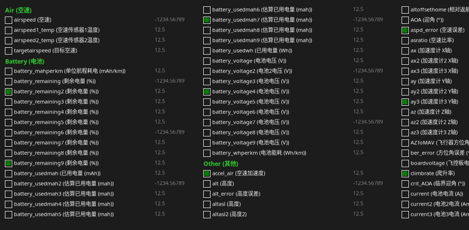
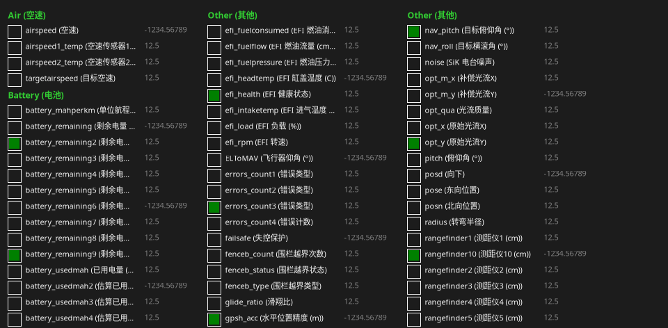

# “显示此项”字段选择弹窗：紧凑完整列

独立主题分支：`fix/19-display-selection-columns`。基线 `b5bca65edef67e73cedc5ef0b7a8343e088b6a68`；本分支只修改字段选择弹窗，不包含其他状态修订。

## 控件和覆盖范围

| 界面 | 控件及入口 | 与本修订的关系 |
| --- | --- | --- |
| “显示此项” | `Controls/DisplayThisForm.cs`；`FlightData.hud_UserItem` 和 `zg1_DoubleClick` 分别用于 HUD 自定义字段及曲线字段选择 | 本次独立修复 |
| HUD 下方“状态”列表 | `Controls/StatusControl.cs`，由 `FlightData` 放入 `tabStatus` | 原 #19 状态修复范围，控件文件未在本分支修改 |
| HUD 下方“快速”仪表卡片 | `tableLayoutPanelQuick` 与 `ExtLibs/Controls/QuickView.cs`，描述在上、数值在下 | 与状态列表不同；本分支未修改该控件 |

不能仅凭“在 HUD 下方”把快速卡片和状态列表视为同一控件。第二张反馈图需要通过实际高亮标签或控件树确认；本修订不宣称已修改快速卡片。

运行候选 `178463cf` 的 `DisplayThisForm.cs` blob 为 `45f2ea758993d5b851dd5429aacdf8757708ad7a`，与本基线相同；其 `StatusControl.cs` 仍为旧的全局名称宽度实现（blob `b638751efdfd7ffd310d8cfa52a8f9ea3f6f4ae9`）。未集成独立修复的运行版本不能作为新修订的界面验收结果。

## 问题与设计

旧弹窗将全部字段名称与分组标题的最大测量宽度作为每列名称宽度，数值固定预留 80 px。它按窗口高度一直横向增加列，因此一个长名称或标题会推远所有数值，右侧可出现半列；后续变长的数值也没有重新计算空间。命中区域在绘制时才更新，搜索或重新布局后到下一次绘制之间仍可能沿用旧边界。

本修订保留原分组、组内排序和字段键：

- 依据可用宽度排下完整列，额外字段向下滚动。分组跨列时重复标题，标题与首个字段在同列。
- 名称和数值按列实际内容测量。名称上限使用当前字体的 16 个宽字符度量；标题不参与名称列宽计算。超长名称/标题显式省略，悬停可查看完整内容。
- 数值保留原 `ToString()` 内容并预留完整测量宽度；单列本身仍过宽时可以横向滚动。普通实时更新保持点击目标稳定，值超出单元格时才重新布局。
- 绘制、悬停提示和点击共享重排时生成的几何信息。搜索从左上角开始，过滤和重排保留勾选状态。
- 保留左键切换及右键先调用原鼠标处理器、再调用勾选处理器的顺序，继续传递原字段 `Name`、完整 `Text`、`Tag="custom"` 和 `Checked`。
- 字号和 DPI 变化重新测量；关闭和释放窗体时清理计时器、字体与提示资源。

## 已执行的定向验证

Linux / Mono 6.12 / Xvfb，实际绘图 96 DPI；使用真实弹窗、搜索控件和字段呈现代码，遥测和主题入口使用 [可审阅替身](dependencies.cs.txt)。

| 范围 | 结果 |
| --- | --- |
| 新增弹窗布局与交互回归 | **20 通过、0 失败、0 跳过**，[targeted.log](targeted.log) |
| 原混合布局测试的状态控件部分 | **1 通过、0 失败**，[legacy.log](legacy.log)；原状态断言保留 |
| 尺寸/字体矩阵 | 320×120、640×320、960×500、1280×800，各测字体 100% / 125% / 150% / 200%，随后同家族再放大 20% |
| 内容/可达性 | 每个字段仅出现一次、顺序保留、完整列不越右边界、无孤立标题、数值完整宽度、滚到底/右端可达 |
| 选择/更新 | 搜索复位、筛选后勾选保留、重排后未绘制即点击、滚动后命中、左右键回调顺序、长文本提示、实时数值增长 |
| 编译 | .NET Framework 4.7.2 引用程序集定向编译通过，`LIB` 条件分支隔离编译通过 |

旧混合测试中“弹窗必须预留全部长标签宽度”的实现断言由独立弹窗用例替代；它与显式省略、紧凑列宽的新要求相反。状态控件的原断言没有放宽，本分支也未改 #19 的状态滚动实现。

字体倍率测试不等于 Windows 系统 DPI 实测。Windows 主程序编译、实际 100% / 125% / 150% / 200% DPI、主题及真实调用路径仍需验收。

## 可公开的对照图

图片来自隔离控件绘制，不是用户照片，也不是已连接飞控的完整程序截图。使用 [219 条仓库标签](catalog.tsv)，分组及数值均为合成数据；无真实位置、账户、设备信息或私人路径。截图只含内容区域，不含搜索框、窗口边框和原生滚动条。几何测量见 [visual.log](visual.log)。

同为 960×472 内容面板、默认字体、96 DPI：旧版横向范围 4486；修订后横向范围 857，三列完整保留，剩余字段纵向滚动。

| 基线 | 修订 |
| --- | --- |
|  |  |

[640 宽、字体 150% 对照后的布局](after-640-font150.png)。该图的横向范围 414，完整单列和长名称省略号可见。

## 复跑

准备 Mono/X11、.NET Framework 4.7.2 引用程序集与 MSTest 2.2.10 后：

```sh
DISPLAY_NET472_REFS=/path/to/build/.NETFramework/v4.7.2 \
DISPLAY_MSTEST_DLL=/path/to/mstest/lib/net45/Microsoft.VisualStudio.TestPlatform.TestFramework.dll \
DISPLAY=:92 bash MissionPlannerTests/Controls/DisplayThisFormEvidence/run-isolated.sh
```

可另设 `DISPLAY_MONO`、`DISPLAY_MCS_EXE` 和 `DISPLAY_TEST_OUTPUT`。脚本不安装软件、不连接飞控，也不构建完整应用；生成临时测试和对照控件。

Windows 过滤器：

```powershell
dotnet test MissionPlannerTests\MissionPlannerTests.csproj -c Release --filter "FullyQualifiedName~DisplayThisFormLayoutTests|FullyQualifiedName~TelemetryFieldPresentationTests" -p:GenerateResourceUsePreserializedResources=true -p:GenerateSerializationAssemblies=Off --logger "trx;LogFileName=display-selection.trx"
```

本分支预期 26 项（20 弹窗 + 6 字段呈现），仍应实测左/右键选择、搜索后返回、长字段/值、系统 DPI、主题以及 HUD/曲线两个入口。与后续 #19 状态分支合并时，保留独立的状态/弹窗布局用例，删除或协调旧混合测试，避免继续使用旧弹窗的全宽名称假设。

### #42 键盘补充（独立于分栏及翻译）

基线 `f47f7bbb8` 的真实弹窗可用键盘输入 `alt` 搜到唯一结果，但 Tab、方向键、空格及 Enter 都无法触发该行；相同坐标鼠标单击可回调原键 `alt`。隔离 Xvfb 96 和 120 DPI 都复现。

本补丁仅让选择区接收焦点：Tab 与 Shift-Tab 可在搜索框和选择区之间切换，当前行显示主题感知焦点边框。选择区内，上下键及 Home/End 按筛选后的原顺序定位并滚动到可见区域，空格复用原勾选回调。Enter 不变；右键仍先调用原处理器再回调，左键行为、键、组、搜索、列布局和保存绑定均不改变。没有新增 UIA/screen reader 行语义。

`keyboard.cs.txt` 通过原生 X 输入验证实际 WinForms 选择器，每个 DPI **36/36**（420×156 深色和 880×280 浅色），含滚动与行几何不变、搜索结果变化、焦点边框像素、左右键回调、两个方向 Tab 离开和空结果。仅主题/遥测最小替身，未触碰硬件。Linux 120 DPI 不能替代 Windows 原生 125% 验收。

后续回归：`9e72d764` 在 X11 真实长按空格 1 秒会因自动重复反复勾选；选择最后一行后从宽窗缩窄，焦点保留但勾选框可落在视口外。现在空格松键只触发一次，失焦取消待处理按键，下次按键仍可用。尺寸、字体或 DPI 重排后，只在选择区拥有焦点时滚回活动行；手动滚动仍可离开该行，不改变活动项。原测试加长按、重复独立按键、失焦、宽窄重排和滚轮断言，共 **51/51**。这仍不是原生 Windows 验收。

在专用的隔离 Xvfb 显示中复跑，**不要给个人正在使用的 DISPLAY 发送输入**：

```sh
DISPLAY=:221 DISPLAY_KEYBOARD_ISOLATED=yes \
  DISPLAY_NET472_REFS=/path/to/net472 \
  DISPLAY_ROSLYN_CSC=/path/to/roslyn/net472/csc.exe \
  bash MissionPlannerTests/Controls/DisplayThisFormEvidence/run-keyboard.sh
```
